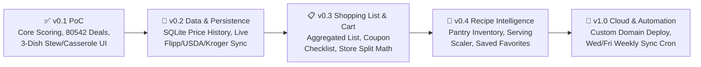

# Project Roadmap: Produce & Commodity Meal-Prep Tracker

This roadmap tracks our evolution from the initial Proof of Concept (`v0.1`) to a fully automated, cloud-hosted weekend meal-prep companion (`v1.0`).

---

## Milestone Overview

### ✅ Milestone 0: `v0.1` — Proof of Concept (Completed)
* Curated catalog of core Proteins, Produce, and Dairy/Eggs with unit normalization (`$/lb`, `$/doz`) and Mountain Region baselines.
* Affordability-First Value Scoring Engine (`55% Affordability + 35% Discount + 10% Wholesale Momentum`) + `💎 Splurge Value Alerts`.
* Deal redemption badges (`📱 Clip Digital Coupon`, `🏷️ Member Card`, `🔢 Multi-Buy`).
* Modular 3-Dish Stew, Braise, Chili, Curry & Casserole matcher + Gemini 2.5 Flash Free-Tier integration.
* Mobile-first 3-tab web dashboard.

---

### 🚧 Milestone 1: `v0.2` — Live Data Pipeline & Historical Price Persistence
**Goal:** Persist weekly price snapshots into a local/cloud SQLite database so the app tracks multi-week price cycles and enriches live API feeds automatically.
* **Ticket #1:** Implement SQLite / Turso persistence layer for weekly `StoreOffer` and `USDA` historical snapshots.
* **Ticket #2:** Enhance Flipp `80542` circular parser with deeper fuzzy matching and multi-buy quantity extraction.
* **Ticket #3:** Complete live Kroger Developer API location lookup & batch product price sync for Firestone/Longmont King Soopers stores.
* **Ticket #4:** Complete live USDA MARS API (`3324`, `3228`, `2868`, `2756`, `2995`) Mountain Region parser & historical trend chart.

---

### 📋 Milestone 2: `v0.3` — Interactive Shopping List & Store Split Optimizer
**Goal:** Turn the selected 3-Dish Meal Prep Trio into an actionable weekend shopping & coupon-clipping checklist.
* **Ticket #5:** Build aggregated Shopping List generator from the active 3-Dish Meal Prep Trio (deduplicating overlapping ingredients like onions, potatoes, and cheese across all 3 dishes).
* **Ticket #6:** Add "Digital Coupon Pre-Flight Checklist" view (grouping all `📱 Digital Coupon` items by King Soopers App vs. Safeway for U App so you can clip them in 60 seconds before leaving home).
* **Ticket #7:** Add Store Trip Optimizer: compare *"1-Stop at King Soopers"* vs. *"1-Stop at Safeway"* vs. *"Split 2-Store Trip"* total basket cost and net savings.

---

### 🍳 Milestone 3: `v0.4` — Meal Prep Customization & Pantry Intelligence
**Goal:** Tailor dish recommendations to what's already in your kitchen, freezer, and recipe rotation.
* **Ticket #8:** Add "Already Have in Pantry/Freezer" toggle so owned ingredients drop to `$0.00` marginal cost and boost matching stews/casseroles.
* **Ticket #9:** Add dynamic serving scaler (`4`, `6`, `8` servings per dish) and basic macro/protein-per-serving estimates.
* **Ticket #10:** Save favorite AI-generated or customized stew/casserole recipes to the local blueprint library.

---

### 🚀 Milestone 4: `v1.0` — Cloud Hosting, Custom Domain & Automated Digest
**Goal:** Host on a custom domain with automated weekly Wednesday circular ingestion.
* **Ticket #11:** Configure production deployment (Vercel / Cloudflare / Cloud Run) + custom domain setup.
* **Ticket #12:** Set up automated Wednesday circular refresh cron job + optional Friday morning "Weekend Meal Prep Value Digest" notification.
