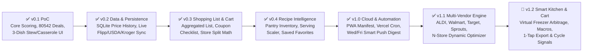

# Project Roadmap: PantryBot (Produce & Commodity Meal-Prep Tracker)

This roadmap tracks our evolution from the initial Proof of Concept (`v0.1`) to a fully automated, cloud-hosted weekend meal-prep companion (`v1.0`).

---

## Milestone Overview

### ✅ Milestone 0: `v0.1` — Proof of Concept (Completed)
* Curated catalog of core Proteins, Produce, and Dairy/Eggs with unit normalization (`$/lb`, `$/doz`) and Mountain Region baselines.
* Affordability-First Value Scoring Engine (`55% Affordability + 35% Discount + 10% Wholesale Momentum`) + `💎 Splurge Value Alerts`.
* Deal redemption badges (`📱 Clip Digital Coupon`, `🏷️ Member Card`, `🔢 Multi-Buy`).
* Modular 3-Dish Stew, Braise, Chili, Curry & Casserole matcher + Gemini 2.5 Flash Free-Tier integration.
* Mobile-first 3-tab web dashboard.

---

### ✅ Milestone 1: `v0.2` — Live Data Pipeline & Historical Price Persistence (Completed)
**Goal:** Persist weekly price snapshots into a local/cloud SQLite database so the app tracks multi-week price cycles and enriches live API feeds automatically.
* **Ticket #1:** Implement SQLite persistence layer (`node:sqlite`) for weekly `StoreOffer` and `USDA` historical snapshots.
* **Ticket #2:** Enhance Flipp `80542` circular parser with deeper fuzzy matching and multi-buy quantity extraction.
* **Ticket #3:** Complete live Kroger Developer API location lookup & batch product price sync for Firestone/Longmont King Soopers stores.
* **Ticket #4:** Complete live USDA MARS API (`3324`, `3228`, `2868`, `2756`, `2995`) Mountain Region parser & historical trend chart.

---

### ✅ Milestone 2: `v0.3` — Interactive Shopping List & Store Split Optimizer (Completed)
**Goal:** Turn the selected 3-Dish Meal Prep Trio into an actionable weekend shopping & coupon-clipping checklist.
* **Ticket #5:** Build aggregated Shopping List generator from the active 3-Dish Meal Prep Trio (deduplicating overlapping ingredients like onions, potatoes, and cheese across all 3 dishes).
* **Ticket #6:** Add "Digital Coupon Pre-Flight Checklist" view (grouping all `📱 Digital Coupon` items by King Soopers App vs. Safeway for U App so you can clip them in 60 seconds before leaving home).
* **Ticket #7:** Add Store Trip Optimizer: compare *"1-Stop at King Soopers"* vs. *"1-Stop at Safeway"* vs. *"Split 2-Store Trip"* total basket cost and net savings.

---

### ✅ Milestone 3: `v0.4` — Meal Prep Customization & Pantry Intelligence (Completed)
**Goal:** Tailor dish recommendations to what's already in your kitchen, freezer, and recipe rotation.
* **Ticket #8:** Add "Already Have in Pantry/Freezer" toggle so owned ingredients drop to `$0.00` marginal cost and boost matching stews/casseroles.
* **Ticket #9:** Add dynamic serving scaler (`4`, `6`, `8` servings per dish) and basic macro/protein-per-serving estimates.
* **Ticket #10:** Save favorite AI-generated or customized stew/casserole recipes to the local SQLite blueprint library.

---

### ✅ Milestone 4: `v1.0` — Cloud Hosting, PWA Manifest & Automated Digest (Completed)
**Goal:** Production PWA deployment config with automated Wednesday circular ingestion & Friday Weekend Prep Digest.
* **Ticket #11:** Configure production deployment (`vercel.json`) + mobile PWA home-screen manifest (`manifest.ts`, `icon.svg`).
* **Ticket #12:** Set up automated Wednesday circular refresh cron job (`/api/cron/weekly-sync`), Smart Push Notification payloads, and Friday "Weekend Meal Prep Value Digest".

---

### ✅ Milestone 5: `v1.1` — Multi-Vendor Expansion & Universal Basket Optimizer (Completed)
**Goal:** Expand geographic accessibility and value density nationwide through ALDI, Walmart, Target, Sprouts, localized banners, and dynamic N-store basket optimization.
* **Ticket #13:** Refactor `StoreChain` into an extensible Store Registry & localized banner model (e.g. Ralphs, Fred Meyer, Fry's, Jewel-Osco, Vons).
* **Ticket #14:** Generalize Shopping List & N-Store basket matrix comparison with dynamic store rankings.
* **Ticket #15:** Add ALDI circular scraper and unit-price extraction via Flipp.
* **Ticket #16:** Add Walmart, Target & Sprouts circular matching and Everyday Low Price floors.
* **Ticket #17:** Auto-detect available local stores by ZIP code in `/api/locations`.
* **Ticket #18:** Add "My Stores" preference selector & active store filter pills.
* **Ticket #19:** Redesign Store Comparison Card with ranked N-store leaderboard & Best 2-Store split.
* **Ticket #20:** Multi-App Digital Coupon Pre-Flight Checklist (Kroger, Safeway, Target Circle).

---

### 🚧 Milestone 6: `v1.2` — Smart Kitchen, Virtual Freezer & Cart Bridge (Active)
**Goal:** Bridge deal discovery and kitchen execution through persistent multi-week freezer arbitrage, personalized macro/dietary profiles, 1-tap cart export, and cycle low price signals.
* **Ticket #21 ([#513](https://github.com/kchavez05/produce-price-tracker/issues/513)):** Persistent Virtual Freezer & Multi-Week Arbitrage Engine ("Buy 2: Prep 1, Freeze 1" prompts, persistent freezer inventory, and automated `$0.00` meal-prep substitution).
* **Ticket #22 ([#514](https://github.com/kchavez05/produce-price-tracker/issues/514)):** Dietary Preferences, Macro Targets & Cooking Style Archetypes (High-Protein, Keto/Low-Carb, Gluten-Free, Dairy-Free, Instant Pot/Slow Cooker, Sheet-Pan).
* **Ticket #23 ([#515](https://github.com/kchavez05/produce-price-tracker/issues/515)):** 1-Tap Curbside Cart Bridge & Multi-Store Export (Walmart, Target, Kroger & Instacart direct search links, formatted Apple Notes/Keep checklist clipboard export, printable slip).
* **Ticket #24 ([#516](https://github.com/kchavez05/produce-price-tracker/issues/516)):** "Stock Up vs. Wait" Predictive Cycle Low Signals (Historical 6-week cycle recognition, Buy Now floor alerts, and Peak Price substitution recommendations).
* **Ticket #25 ([#517](https://github.com/kchavez05/produce-price-tracker/issues/517)):** Wholesale Club Price Normalizer (Costco & Sam's Club $/lb benchmark comparison to confirm when supermarket sales beat bulk club prices).

---

## 📱 Horizon 2 & 3: Native iOS / Android & Feature Expansion (`v1.5` – `v3.0`)

For the long-term mobile architecture (Turborepo + Expo React Native), native hardware features (Camera Shelf-Tag OCR, iOS Live Activities, Push Alerts), Virtual Freezer arbitrage loop, and nationwide store expansion, see:
* **[North Star Strategy: Native iOS/Android Roadmap & Feature Expansion Blueprint](./docs/wiki/Long-Term-Mobile-and-Expansion-Roadmap.md)**

