# Project Roadmap: PantryBot (Produce & Commodity Meal-Prep Tracker)

This roadmap tracks our evolution from the initial Proof of Concept (`v0.1`) to a fully automated, cloud-hosted weekend meal-prep companion (`v1.0`).

## v1.5.1 — Data Explorer & Score Transparency

Delivered a public data explorer with price charts and weekly patterns, exact score explanations, ingredient grouping rationale, and a first-class raw-data view with source JSON and filtered exports. See the [approved specification](docs/specs/data-explorer-and-score-transparency.md). Policy decisions and operational constraints are recorded in the [explorer guide](docs/data-explorer.md).

## v1.5.2 — Data clarity and active-market collection

Track requested ZIPs in a shared, server-only registry. Archive a first due dashboard refresh, then collect active markets in bounded scheduled batches. Initial budget: nine active ZIPs, active for 30 days after use, refresh every three days, three claims per daily worker invocation. Failed collections become eligible after one hour; leases prevent duplicate work and recover interrupted jobs. No credentials retains offline behavior. Activate the migration and schedule through reviewed release changes.

## Future — Nationwide local-price coverage

Expand toward all US ZIPs using provider-supported bulk access and queued collection. Deduplicate shared store/circular coverage rather than storing identical advertisements once per ZIP; retain store-specific exceptions, source validity, package details, and collection provenance. Add real store/ad-market identity, provider rate budgets, coverage/freshness monitoring, and measured storage/retention planning before national rollout. Historical backfill requires genuine dated source advertisements. Active-market collection is the first stage, not a claim of nationwide historical coverage.

## v1.5.0 — Weekly USDA and durable market history

Implementation adds Wednesday-only USDA batches, immutable Supabase raw/normalized history, explicit source freshness, operator backfill/recovery, shared local-price archival, and synthetic-data quarantine. Historical analytics screens are delivered in v1.5.1; ordinary reads still never call USDA. See the [approved spec](docs/specs/usda-weekly-ingestion-and-market-history.md) and [operations guide](docs/usda-market-data.md). Production activation requires reviewed migration, validated source definitions, and release verification.

```mermaid
flowchart LR
    M0["✅ v0.1 PoC\nCore Scoring, 80542 Deals,\n3-Dish Stew/Casserole UI"] --> M1["✅ v0.2 Data & Persistence\nSQLite Price History, Live\nFlipp/USDA/Kroger Sync"]
    M1 --> M2["✅ v0.3 Shopping List & Cart\nAggregated List, Coupon\nChecklist, Store Split Math"]
    M2 --> M3["✅ v0.4 Recipe Intelligence\nPantry Inventory, Serving\nScaler, Saved Favorites"]
    M3 --> M4["✅ v1.0 Cloud & Automation\nPWA Manifest, Vercel Cron,\nWed/Fri Smart Push Digest"]
    M4 --> M5["✅ v1.1 Multi-Vendor Engine\nALDI, Walmart, Target, Sprouts,\nN-Store Dynamic Optimizer"]
    M5 --> M6["✅ v1.2 Smart Kitchen & Cart\nVirtual Freezer Arbitrage, Macros,\n1-Tap Export & Cycle Signals"]
    M6 --> M7["✅ v1.3 User Accounts & Cloud Sync\nSupabase SSO, Postgres RLS,\nCross-Device Sync & Legal Footer"]
    M7 --> M8["✅ v1.4 Developer Platform & OpenAPI\nOpenAPI 3.1.0 Spec, Swagger UI Console,\nTyped Schemas & Interactive Testing"]
```

---

## Milestone Overview

### ✅ Milestone 0: `v0.1` — Proof of Concept (Completed)
* Curated catalog of core Proteins, Produce, and Dairy/Eggs with unit normalization (`$/lb`, `$/doz`) and Mountain Region baselines.
* Affordability-First Value Scoring Engine (`55% Affordability + 35% Discount + 10% Wholesale Momentum`) + `💎 Splurge Value Alerts`.
* Deal redemption badges (`📱 Clip Digital Coupon`, `🏷️ Member Card`, `🔢 Multi-Buy`).
* Modular 3-Dish Stew, Braise, Chili, Curry & Casserole matcher + Gemini 2.5 Flash Free-Tier integration.
* Mobile-first 3-tab web dashboard.

---

### ✅ Milestone 1: `v0.2` — Live Data Pipeline & Historical Price Persistence (Completed)
**Goal:** Persist weekly price snapshots into a local/cloud SQLite database so the app tracks multi-week price cycles and enriches live API feeds automatically.
* **Ticket #1:** Implement SQLite persistence layer (`node:sqlite`) for weekly `StoreOffer` and `USDA` historical snapshots.
* **Ticket #2:** Enhance Flipp `80542` circular parser with deeper fuzzy matching and multi-buy quantity extraction.
* **Ticket #3:** Complete live Kroger Developer API location lookup & batch product price sync for Firestone/Longmont King Soopers stores.
* **Ticket #4:** Complete live USDA MARS API (`3324`, `3228`, `2868`, `2756`, `2995`) Mountain Region parser & historical trend chart.

---

### ✅ Milestone 2: `v0.3` — Interactive Shopping List & Store Split Optimizer (Completed)
**Goal:** Turn the selected 3-Dish Meal Prep Trio into an actionable weekend shopping & coupon-clipping checklist.
* **Ticket #5:** Build aggregated Shopping List generator from the active 3-Dish Meal Prep Trio (deduplicating overlapping ingredients like onions, potatoes, and cheese across all 3 dishes).
* **Ticket #6:** Add "Digital Coupon Pre-Flight Checklist" view (grouping all `📱 Digital Coupon` items by King Soopers App vs. Safeway for U App so you can clip them in 60 seconds before leaving home).
* **Ticket #7:** Add Store Trip Optimizer: compare *"1-Stop at King Soopers"* vs. *"1-Stop at Safeway"* vs. *"Split 2-Store Trip"* total basket cost and net savings.

---

### ✅ Milestone 3: `v0.4` — Meal Prep Customization & Pantry Intelligence (Completed)
**Goal:** Tailor dish recommendations to what's already in your kitchen, freezer, and recipe rotation.
* **Ticket #8:** Add "Already Have in Pantry/Freezer" toggle so owned ingredients drop to `$0.00` marginal cost and boost matching stews/casseroles.
* **Ticket #9:** Add dynamic serving scaler (`4`, `6`, `8` servings per dish) and basic macro/protein-per-serving estimates.
* **Ticket #10:** Save favorite AI-generated or customized stew/casserole recipes to the local SQLite blueprint library.

---

### ✅ Milestone 4: `v1.0` — Cloud Hosting, PWA Manifest & Automated Digest (Completed)
**Goal:** Production PWA deployment config with automated Wednesday circular ingestion & Friday Weekend Prep Digest.
* **Ticket #11:** Configure production deployment (`vercel.json`) + mobile PWA home-screen manifest (`manifest.ts`, `icon.svg`).
* **Ticket #12:** Set up automated Wednesday circular refresh cron job (`/api/cron/weekly-sync`), Smart Push Notification payloads, and Friday "Weekend Meal Prep Value Digest".

---

### ✅ Milestone 5: `v1.1` — Multi-Vendor Expansion & Universal Basket Optimizer (Completed)
**Goal:** Expand geographic accessibility and value density nationwide through ALDI, Walmart, Target, Sprouts, localized banners, and dynamic N-store basket optimization.
* **Ticket #13:** Refactor `StoreChain` into an extensible Store Registry & localized banner model (e.g. Ralphs, Fred Meyer, Fry's, Jewel-Osco, Vons).
* **Ticket #14:** Generalize Shopping List & N-Store basket matrix comparison with dynamic store rankings.
* **Ticket #15:** Add ALDI circular scraper and unit-price extraction via Flipp.
* **Ticket #16:** Add Walmart, Target & Sprouts circular matching and Everyday Low Price floors.
* **Ticket #17:** Auto-detect available local stores by ZIP code in `/api/locations`.
* **Ticket #18:** Add "My Stores" preference selector & active store filter pills.
* **Ticket #19:** Redesign Store Comparison Card with ranked N-store leaderboard & Best 2-Store split.
* **Ticket #20:** Multi-App Digital Coupon Pre-Flight Checklist (Kroger, Safeway, Target Circle).

---

### ✅ Milestone 6: `v1.2` — Smart Kitchen, Virtual Freezer & Cart Bridge (Completed)
**Goal:** Bridge deal discovery and kitchen execution through persistent multi-week freezer arbitrage, personalized macro/dietary profiles, 1-tap cart export, and cycle low price signals.
* **Ticket #21 ([#513](https://github.com/kchavez05/produce-price-tracker/issues/513)):** Persistent Virtual Freezer & Multi-Week Arbitrage Engine ("Buy 2: Prep 1, Freeze 1" prompts, persistent freezer inventory, and automated `$0.00` meal-prep substitution).
* **Ticket #22 ([#514](https://github.com/kchavez05/produce-price-tracker/issues/514)):** Dietary Preferences, Macro Targets & Cooking Style Archetypes (High-Protein, Keto/Low-Carb, Gluten-Free, Dairy-Free, Instant Pot/Slow Cooker, Sheet-Pan).
* **Ticket #23 ([#515](https://github.com/kchavez05/produce-price-tracker/issues/515)):** 1-Tap Curbside Cart Bridge & Multi-Store Export (Walmart, Target, Kroger & Instacart direct search links, formatted Apple Notes/Keep checklist clipboard export, printable slip).
* **Ticket #24 ([#516](https://github.com/kchavez05/produce-price-tracker/issues/516)):** "Stock Up vs. Wait" Predictive Cycle Low Signals (Historical 6-week cycle recognition, Buy Now floor alerts, and Peak Price substitution recommendations).
* **Ticket #25 ([#517](https://github.com/kchavez05/produce-price-tracker/issues/517)):** Wholesale Club Price Normalizer (Costco & Sam's Club $/lb benchmark comparison to confirm when supermarket sales beat bulk club prices).

---

### ✅ Milestone 7: `v1.3` — User Accounts, Cloud Sync & Legal Foundation (Completed)
**Goal:** Introduce user authentication, multi-tenant cloud persistence with PostgreSQL Row-Level Security (RLS), cross-device sync for Virtual Freezer inventory and meal-prep profiles, self-serve account/privacy management, and essential legal compliance (Privacy Policy, Terms of Service, Copyright & Contact).
* **Ticket #26 ([#523](https://github.com/kchavez05/produce-price-tracker/issues/523)):** Supabase Auth Foundation, Next.js Middleware & Google SSO (`@supabase/ssr`, edge session refreshment, PKCE flow, navbar auth state, and zero-key offline resilience).
* **Ticket #27 ([#524](https://github.com/kchavez05/produce-price-tracker/issues/524)):** Multi-Tenant PostgreSQL Schema with Row-Level Security (RLS) (`users`, `user_preferences`, `user_freezer_items`, and `user_saved_recipes` with database-level isolation policies).
* **Ticket #28 ([#525](https://github.com/kchavez05/produce-price-tracker/issues/525)):** Cloud Sync Engine & Guest-to-Account Migration (`useUserSync` bi-directional sync, 1-click local storage to cloud migration prompt, and optimistic updates).
* **Ticket #29 ([#526](https://github.com/kchavez05/produce-price-tracker/issues/526)):** Account Management UI, Data Privacy & Self-Serve Controls (User profile drawer, 1-click JSON data export, and 2-step account deletion / right to be forgotten).
* **Ticket #30 ([#527](https://github.com/kchavez05/produce-price-tracker/issues/527)):** Sign in with Apple & Security Hardening (Apple OAuth provider, Apple HIG button, endpoint rate-limiting, and zero-key offline test suite).
* **Ticket #31 ([#528](https://github.com/kchavez05/produce-price-tracker/issues/528)):** Legal Foundation & App Footer (Global footer with copyright tag and contact link, `/privacy` Privacy Policy page, and `/terms` Terms & Conditions page).

---

### ✅ Milestone 8: `v1.4` — Developer Platform & OpenAPI Standards (Completed)
**Goal:** Align backend architecture with OpenAPI 3.1.0 standards, publish an interactive Swagger UI testing console, and expose complete typed API schemas for third-party developers, mobile companion apps, and automated client SDK generators.
* **Ticket #32 ([#541](https://github.com/kchavez05/produce-price-tracker/pull/541)):** OpenAPI 3.1.0 Specification Architecture (`src/lib/openapi/spec.ts`, `/api/openapi.json`, and static schema fallback with complete operation contracts across all 8 backend API domains).
* **Ticket #33 ([#541](https://github.com/kchavez05/produce-price-tracker/pull/541)):** Interactive Swagger UI Console (`src/components/SwaggerUIConsole.tsx`, `/docs`, `/api-docs` redirect, and PantryBot emerald theme styling).
* **Ticket #34 ([#541](https://github.com/kchavez05/produce-price-tracker/pull/541)):** Automated OpenAPI Test Suite & Sync Tooling (`npm run openapi:export`, `tests/unit/backend/openapi-spec.test.ts`, and `tests/smoke/backend/openapi-smoke.test.ts`).

---

## v1.4.1 — Price Freshness and Sync Reliability

- Implemented current ad-cycle calculation, live-offer expiration guards, labeled estimates and consistent verified-price shopping recommendations (#559).
- Added durable audit support, protected scheduled refreshes and rolling six-week history.
- Included the reviewed session-isolation and sync-reliability work (#554).
- Production rollout and the next naturally scheduled execution remain release verification steps. See [release notes](docs/releases/v1.4.1.md).

---

## v1.6 — Virtual Pantry

- **v1.6.0 (released):** Account-persistent Virtual Pantry with explicit Yes/No ingredient availability, search, optional quick-add suggestions, custom generic ingredients, optional inventory details, and recipe integration. No automatic inventory deductions. See the [approved specification](docs/specs/v1.6.0-virtual-pantry.md).
- **Catalog standards:** Approved standards for repeatable USDA ingestion and a curated cooking-ingredient layer with optional varieties, compact search, and stable IDs. See the [approved ingestion spec](docs/specs/usda-catalog-ingestion.md); the initial approved 72-identity catalog, optional varieties, directional coverage, and market-link audits are implemented. Further category batches remain future curation work.
- **v1.6.1 (in planning):** Pantry Catalog Expansion before speech entry. Complete reviewed category batches, provenance, compact discovery, applicable market/recipe links, and exception/coverage audits. The [implementation plan](docs/specs/v1.6.1-pantry-catalog-expansion.md) tracks the work; the [first exact batch](docs/research/v1.6.1-legumes-grains-flours-review.md) records the approved 29 additions and six provenance updates, integrated as catalog `2026-10-31.1`. The [second approved batch](docs/research/v1.6.1-vegetables-aromatics-review.md) adds ten fresh ingredients and five provenance updates, compiling catalog `2026-11-06.1` with 111 identities. The [third approved batch](docs/research/v1.6.1-staples-proteins-review.md) adds 23 staples/protein/dairy choices with three explicit source-specific inclusion overrides, compiling catalog `2026-11-06.2` with 134 identities. The [whole/ground spice batch](docs/research/v1.6.1-shared-spice-references.md) shares generic USDA records explicitly and brings catalog `2026-11-06.3` to 138 identities. The [remaining vegetable mappings](docs/research/v1.6.1-vegetable-recipe-mappings-review.md) add seven approved fresh identities and 22 scoped recipe uses, bringing catalog `2026-11-06.4` to 145. Hosted rollout remains pending.
- **Speech-to-inventory (after catalog expansion; version unassigned):** Dictate, review/correct, and explicitly confirm additions.
- **v1.6.2 (planned):** Barcode scanning with mapping to generic ingredients and user confirmation/correction, plus dynamic pantry-staple pricing (v1.6.0 uses fixed estimates).

---

## Planned v1.7 — Sign in to Access AI Features

**Goal:** Make app-funded AI assistance standard for all signed-in users, replacing the bring-your-own API key experience. Initial focus: recipe remix and speech-to-inventory (scheduled after pantry catalog expansion).

- Remove the bring-your-own-key input and retire the user-supplied-key request path. Remove previously stored user keys from app-managed browser storage during migration; never upload them.
- Offer a clear **Sign in to access AI features** action to guests. Enforce authenticated access on the server, with provider credentials held server-side.
- Give every signed-in user access at launch, without requiring payment, a subscription, or a personal API key. Add appropriate account-based usage limits and recoverable service-error states.
- Preserve manual pantry entry and deterministic recipe suggestions for guests and when AI is unavailable.
- Plan for a future paid entitlement model, but leave billing, subscriptions, and a paywall out of v1.7.

**Sequencing:** v1.6.1 now prioritizes pantry catalog expansion. Speech follows that work with its release number unassigned; barcode scanning remains separately planned for v1.6.2. Define speech's interim access and funding behavior in its own spec; v1.7 standardizes access across AI features. This roadmap entry does not expand the approved v1.6.0 scope.

---

## 📱 Horizon 2 & 3: Native iOS / Android & Feature Expansion (`v1.5` – `v3.0`)

For the long-term mobile architecture (Turborepo + Expo React Native), native hardware features (Camera Shelf-Tag OCR, iOS Live Activities, Push Alerts), Virtual Freezer arbitrage loop, and nationwide store expansion, see:
* **[North Star Strategy: Native iOS/Android Roadmap & Feature Expansion Blueprint](./docs/wiki/Long-Term-Mobile-and-Expansion-Roadmap.md)**

