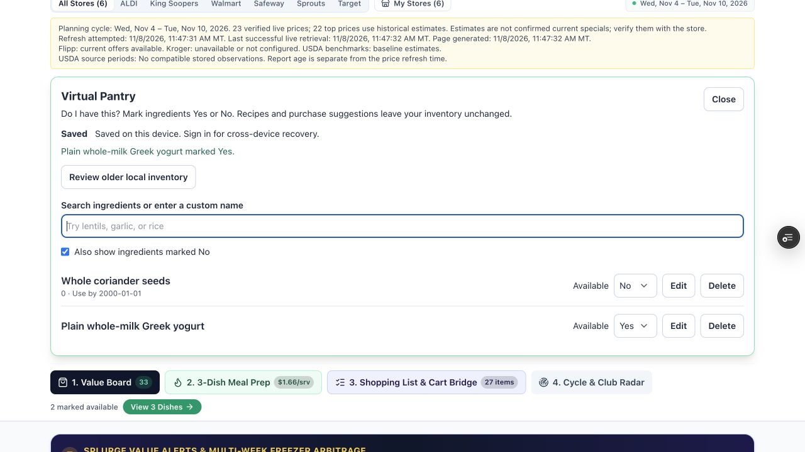
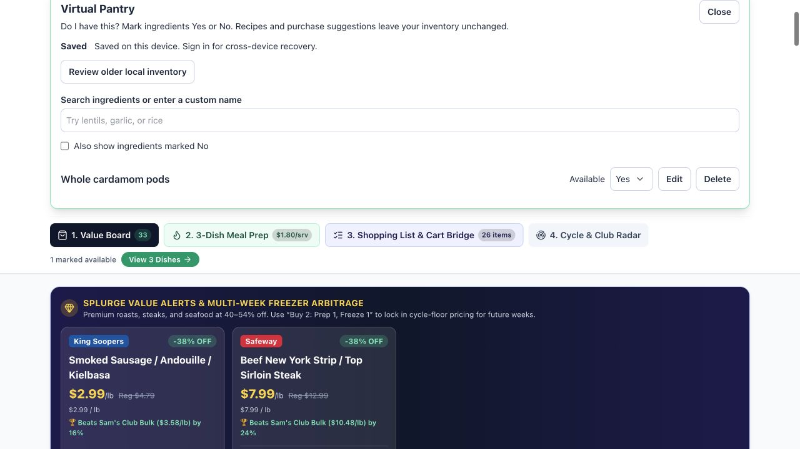

# v1.6.1 — Pantry Catalog Expansion

Retrospective record (November 11, 2026): [closed milestone v1.6.1](https://github.com/kchavez05/produce-price-tracker/milestone/16); original [GitHub publication](https://github.com/kchavez05/produce-price-tracker/releases/tag/v1.6.1) dated 2026-11-08 (America/Denver). See the [release audit](retrospective-audit-2026-11-11.md#v161) for verified gates, gaps and follow-ups. Earlier preparation steps below remain historical context.

Status: released to production November 8, 2026. Catalog audit, all 222 hosted IDs, production authenticated API and guest-browser verification pass.

## Pantry choices and evidence

The reviewed cooking catalog grows from 72 to 222 identities. The 150 additions cover legumes, grains, flours, vegetables, fresh aromatics, oils/spices/condiments, proteins and dairy. Whole and ground coriander/cardamom remain distinct; whole coriander is discoverable as coriander seed, and whole cardamom as cardamom pods. Reviewed shared USDA family references do not claim form-specific nutrition.

All 252 curation decisions are approved. There are 175 source-linked identities, 178 identity-evidence links, five general-reference links and 47 explicitly curated identities without links. The retained October 29 source snapshot is replayed, not a live USDA refresh. The 74-row hold remains unchanged and unassigned through its April 30, 2027 review deadline.

All 457 discovery fixtures, 222 names, 225 aliases and optional choices are reachable. Broad queries remain compact without truncation. Five explicitly approved v1.6.1 boundaries defer further bean, lentil, rice, flour and preservation/texture expansion with recorded revisit conditions; they do not claim culinary completeness.

## Recipes, ownership and prices

All 35 market groups have reviewed counterpart paths: 85 counterpart records and 63 scoped recipe uses. The 20 mixed groups remain protected against accidental component ownership. Raw/fully cooked proteins, bone/skin, named cuts, mozzarella moisture and yogurt flavor/fat retain their reviewed distinctions. The breakfast casserole requires both 8 oz cottage cheese and 8 oz cheddar; dairy-free adaptation omits both slots.

Four precise existing foods require actual offer evidence before store selection, recipe pricing and shopping: Hass avocado, raw boneless/skinless chicken breast, fresh green cabbage and fresh sweet potato. Bare yam labels do not establish sweet potato. Unknown group history or estimated regular prices cannot assert specific-food savings. Native exact Yes/No ownership remains valid even without a qualifying quote.

Three stable-recipe exclusions block unsupported cabbage/sweet-potato requirements, including stale matched/literal saved recipes. Reviewed preparation edits cover thawing, safe cooking methods and named alternatives. No new fixed prices, nutrition conversions or inventory deductions are introduced. Guest/custom ownership and account-bound retries remain private; eleven historical catalog views are retained.

## Validation and audit

The [final audit](../research/v1.6.1-release-audit.md) binds catalog `2026-11-07.4`, the runtime, source snapshot, approval ledgers, recipe methods and additive migrations. Local checks include typecheck, lint, 801 unit, 28 smoke and 37 regression tests, catalog projection, deterministic audit replay and production build. Hosted and deployed production sessions are verified separately below.

## Hosted rollout record

A read-only November 8 check of `pantry-bot` (`vrzhkekeywgrohqgfhds`, default main database) found 72 accepted IDs and 150 missing. Base migrations are installed under different historical timestamps; compare their names and inspect accepted IDs independently. RLS is enabled on all four pantry tables. No hosted mutation was performed by this audit. The branch API reports historical `MIGRATIONS_FAILED` metadata; live SQL reads succeeded, and no separate staging branch was found. That metadata is not an authenticated persistence test.

These reviewed additive migrations were installed in order. For a new hosted installation, apply them after the base pantry migrations, then verify `public.pantry_catalog` contains all 222 accepted IDs. Every migration uses `ON CONFLICT DO NOTHING`; preserve accepted rows and private inventory on rollback.

1. `20261031143749_pantry_legumes_grains_flours.sql` — 29 IDs.
2. `20261106155015_pantry_vegetables_aromatics.sql` — 10 IDs.
3. `20261106161943_pantry_staples_proteins.sql` — 23 IDs.
4. `20261106170650_pantry_spice_forms.sql` — 4 IDs.
5. `20261106175108_pantry_remaining_vegetables.sql` — 7 IDs.
6. `20261107144458_pantry_market_produce.sql` — 26 IDs.
7. `20261107172039_pantry_market_proteins.sql` — 28 IDs.
8. `20261108005922_pantry_market_dairy.sql` — 23 IDs.

Exact SQL file hashes and missing IDs are in the [rollout readiness receipt](../../catalog/audits/2026-11-08-release/rollout-readiness.json). The eight migrations were explicitly approved and applied November 8. The [post-migration receipt](../../catalog/hosted-readiness/2026-11-08-post-migrations.json) verifies exactly 222 accepted IDs, no missing/unexpected IDs, and one hosted history entry for each migration. All original IDs remain present and RLS remains enabled on all four pantry tables. The exact SQL targets only `public.pantry_catalog`; no inventory rows, grants, policies or pantry flag were changed. Hosted migration timestamps differ from local filenames, and the receipt maps each exact file hash to its installed history version. The pre-rollout observation remains unchanged. Fresh authenticated and second-client results are now recorded in the verification receipts below.

## Release record

- All exact catalog/scope approvals, source audits and hosted migrations are complete; 222 accepted IDs are installed.
- Release PR #615 passed CI, Preview and completed latest-head Codex review; its finding was fixed and the thread resolved before the approved merge.
- Typecheck, lint, catalog projection, build and all 866 local tests pass (801 unit, 28 smoke, 37 regression).
- Production authenticated API and guest-browser checks pass; disposable test accounts and entries are removed.
- Main and develop were synchronized. No v1.6.1 milestone existed at publication; it was backfilled in the retrospective record above.
- The [v1.6.1 GitHub release](https://github.com/kchavez05/produce-price-tracker/releases/tag/v1.6.1) records the final tagged commit.

Speech entry, barcode scanning, dynamic staple prices, funding/access redesign and recurring ingestion are outside this release.

## Hosted session verification progress

The [authenticated-session receipt](../../catalog/hosted-readiness/2026-11-08-session-verification.json) records 15 passing checks against hosted Supabase using two disposable accounts and three independent authenticated sessions. Two sessions for account A saved/reloaded ten representative new ingredients spanning all eight migration batches; account B could not read A through RPC or RLS. The authenticated registry returned exactly 222 IDs. Retries, changed idempotency payloads, duplicate identities, stale revisions, tombstones, unknown IDs, denied direct writes and denied anonymous RPC calls behaved as expected. Persisted exact No/custom entries were evaluated with the current client availability model, without claiming a browser rendering check. Both temporary accounts, their sessions and scoped profile/pantry/mutation rows were cleaned up.

The maintainer completed Vercel sign-in and its passkey verification. A new non-sensitive `PANTRYBOT_PANTRY_ENABLED=true` setting is scoped only to Preview → develop; Production and deployment protection are unchanged. Exact source commit `3f49f211903b8d438a90d847b256bb0757d23d91` rebuilt successfully as deployment `dpl_Dh1wmjnzTTzWKj3b8SqjRB6bDq9i`. The protected preview now exposes the enabled pantry API with 222 unique accepted IDs and catalog version `2026-11-07.4`.

The [deployed API receipt](../../catalog/hosted-readiness/2026-11-08-deployed-api-verification.json) records 15 passing tests through actual Next.js routes using fresh independent SSR cookie sessions. Ten representative new identities from all eight batches saved without quantities and reloaded in the second client. Private/no-store reads, 409 identity/revision/owner conflicts, same-origin rejection, idempotent retries, custom entries, export, tombstones, sign-out and account deletion all passed. The existing authenticated CLI supplied a short-lived same-project development identity for preview access; no share link or protection-bypass secret was created. Both newly created accounts and their scoped rows were removed.

Guest-browser verification covered separate spice forms, eleven primary flour choices, three mozzarella forms, optional rice-flour/yogurt choices, quantity-free save/reload, explicit No, quantity/date independence and origin-isolated guests. No console warnings/errors were captured. Both test entries were removed. The screenshot shows the verified test state before cleanup:

Verification limits: authenticated API clients use real fresh Supabase sessions; a live Google/Apple OAuth UI roundtrip was not repeated in this batch. Browser offline switching is not exposed by the browser automation controls. Durable offline queues, reload/retry and account cache separation pass the required local unit/regression suites; deployed mutation retry/conflict behavior was independently verified. These results do not claim that a physical device was put offline. No existing customer inventory was modified during these preview checks. Production completion is recorded below.

## Release-review correction

The release review identified that fully cooked plant-based/vegan sausage titles could pass the generic smoked-sausage meat classifier. A shared animal-food gate now rejects explicit plant-based, vegan, vegetarian, meatless/meat-free, imitation, mock and faux descriptions before any of the seven reviewed protein groups can qualify an offer. It handles ordinary and Unicode hyphenation. Existing approved meat identities, positive cooking-state/species/cut cases, native ownership, raw observations and prices are unchanged.

Twenty-one new regression cases cover substitute titles, the other six protein groups, counterpart/recipe admission and cheaper substitute offers competing with valid meat. Recipe costs and shopping provenance use the valid meat quote, preserving input data and selected-store boundaries. The complete local suite now passes 801 unit, 28 smoke and 37 regression tests (866 total), with typecheck, lint, catalog projection and production build. Earlier verification receipts retain their historical test totals and source commit; this correction changes only title admission and its tests, without altering catalog content, accepted IDs, authentication, persistence or inventory.

## Production completion — November 8, 2026

The maintainer approved the production release at reviewed head `3319fc1`. [Release PR #615](https://github.com/kchavez05/produce-price-tracker/pull/615) merged as `d9982b30160eb9f273795eedf12bab6679524d28`. Vercel production deployment `dpl_DYzxbZJM4ZQAdE4ayPtEie6mRXix` is Ready and serves [pantrybot.dev](https://www.pantrybot.dev). Main and develop were synchronized after the merge.

The [production receipt](../../catalog/hosted-readiness/2026-11-08-production-verification.json) records 15 passing authenticated API checks through deployed Next.js routes to hosted Supabase, using two disposable accounts and three independent cookie sessions. All 222 IDs, cross-client persistence, account isolation, retries/conflicts, export and deletion pass. Both test accounts and their scoped rows were verified deleted. A fresh production guest discovered separate cardamom forms and saved/reloaded whole cardamom pods without quantity; its test entry was then removed. No console warnings/errors were captured. The screenshot records the test state before cleanup.

No existing customer inventory was changed. These checks use real fresh authenticated sessions but do not repeat Google/Apple OAuth UI login or physical browser offline switching. Required local suites cover durable offline queues and recovery. The frozen pre-rollout audit and earlier preview receipts remain historical evidence.
