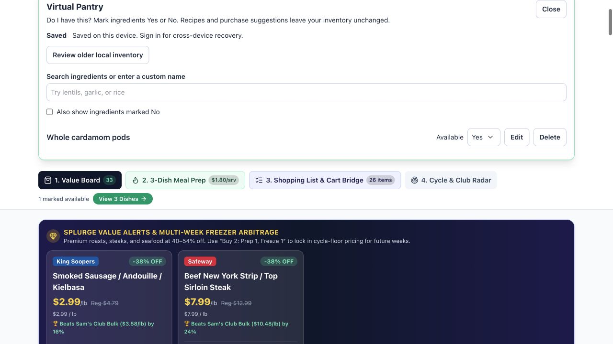

# v1.6.1 final integrated catalog audit

Audited November 8, 2026 against merged develop commit `3517ead32940f8805e57739bb90e2c2bbd5ebeb2` and catalog `2026-11-07.4`. The local audit passes. The eight hosted accepted-ID migrations are now applied and verified; authenticated deployed API and guest-browser checks pass, with the limits below. Production verification now passes; see the completion record below.

The [machine report](../../catalog/audits/2026-11-08-release/audit.json) binds the actual artifact, runtime, curation/coverage ledgers, blueprint methods, source fingerprint and audit code. It supersedes the original research audit as the current local completion assessment. Historical packets and their approval receipts are preserved unchanged.

| Check | Result |
| --- | --- |
| Ingredients and curation | 222 identities; all 252 decisions approved and hash-bound |
| Evidence | 175 source-linked identities; 178 identity links; five general references; 47 curated without links |
| Original shortlist | All 42 research choices resolved |
| Discovery | 457 fixtures; all 222 names and 225 aliases; optional navigation; 17 unbounded broad queries remain at most 12 results |
| Market applicability | All 222 identities classified: 99 linked, 123 with reasoned no-market disposition |
| Market coverage | All 35 groups have paths; 85 counterparts; 63 scoped uses; 20 protected mixed groups |
| Final qualification | Four exact offer gates and three narrow recipe exclusions match approved payloads and current methods |
| Release scope | Five revision-2 boundaries explicitly approved; no research approval outstanding |
| Sources and rollback | Deterministic full-source replay; 74 held rows unchanged/unassigned; eleven historical views exact |
| Accepted-ID migrations | Eight additive files exactly cover all 150 additions beyond the original 72 |

The retained source snapshot SHA-256 is `9d6d4b5bf5c6a4a0ceffcc09aed2f4025acefa7844e5b9a43526c988808cd5a6`. This is a replay of reviewed evidence, not a new USDA refresh. The hold owner and April 30, 2027 deadline remain valid. The [ingredient audit](../../catalog/audits/2026-11-08-release/ingredient-audit.json) records a decision, rationale, provenance and market classification for every identity.

## Historical pre-rollout observation

The [hosted observation](../../catalog/hosted-readiness/2026-11-08.json) was read-only and queried only public catalog IDs and schema metadata. The `pantry-bot` default main database accepted 72 IDs at that pre-rollout observation and lacks all 150 additions; all eight expansion migration names are absent. RLS is enabled on the four pantry tables. No separate staging branch was found. A historical failed-migrations branch status is retained as metadata, not proof that current SQL or sessions fail. At that observation, fresh authenticated and second-client checks had not run. No production deployment, inventory mutation or migration was performed.

The [release record](../releases/v1.6.1.md) lists the eight exact migrations, persistence checks and verification receipts. All catalog research choices and non-market boundaries are settled for v1.6.1; missing hosted IDs and session verification are operational work, not deferred catalog scope.

Reproduce from the repository root, with the retained full source snapshot present:

```sh
npm run catalog:audit-release -- --review data/fdc-catalog-review/2026-10-30-fingerprinted --output catalog/audits/2026-11-08-release --as-of 2026-11-08 --hosted catalog/hosted-readiness/2026-11-08.json --check
```

Omit `--check` only with a new output directory; existing audit evidence is never overwritten. Audit replay validates local data and the captured hosted observation; it does not re-query hosted state or certify authenticated sessions. The frozen pre-rollout observation must be replaced by a new dated receipt after hosted changes.

## Approved hosted migration completion

After the pre-rollout audit, the maintainer explicitly approved the eight hosted migrations. The [new post-migration receipt](../../catalog/hosted-readiness/2026-11-08-post-migrations.json) verifies exactly 222 accepted IDs, no missing/unexpected IDs, preservation of the original 72, and all eight migration names in hosted history. It records each exact local file hash and generated hosted version. All four pantry tables still have RLS enabled. Applied SQL targeted only the accepted-ID registry; it did not target personal inventory or change grants, policies or the pantry flag. At this migration stage, fresh authenticated and second-client verification and production release were still open; both are completed below. The original audit/hosted observations remain immutable historical evidence, so replaying them intentionally reproduces the pre-rollout gap.

## Authenticated data-boundary verification

The [session verification receipt](../../catalog/hosted-readiness/2026-11-08-session-verification.json) records 15 successful hosted Auth/RPC/RLS checks, including cross-session persistence of representative additions from all eight batches, exactly 222 authenticated catalog IDs, account isolation, idempotency, identity/revision conflicts and deletion tombstones. All newly created disposable accounts and their scoped rows were removed. This verifies the hosted data boundary. The maintainer subsequently completed Vercel sign-in and passkey verification. The develop-only preview flag took effect in the rebuilt protected deployment `dpl_Dh1wmjnzTTzWKj3b8SqjRB6bDq9i` at exact source commit `3f49f211903b8d438a90d847b256bb0757d23d91`.

The [deployed API verification](../../catalog/hosted-readiness/2026-11-08-deployed-api-verification.json) adds 15 passing tests with actual independent SSR-cookie sessions against Next.js routes and hosted Supabase. It verifies owner binding, 222 authenticated IDs, quantity-free save/reload across all eight batches, isolation, duplicate/revision conflicts, retries, foreign-Origin rejection, custom entries, export, tombstones, sign-out and account deletion. Both disposable accounts and all their scoped rows were removed. Preview access used an existing short-lived same-project identity; no share links, protection changes or production deployment were involved.

The browser receipt additionally records successful guest add/save/reload, quantity/date independence, explicit No, spice-form distinction, compact flour/mozzarella discovery, optional rice-flour/yogurt navigation and a second origin with an empty isolated guest pantry. No console warnings/errors were captured, and both test entries were deleted. See the [test-state screenshot](assets/v1.6.1-pantry-preview-verified.jpg).

Authenticated API checks do not claim a repeated Google/Apple OAuth UI roundtrip. Browser offline switching is unavailable in the automation interface; durable offline/reload/owner-bound retry behavior is covered by the required local unit/regression suites, with actual deployed idempotency/conflict checks recorded separately. These preview results preceded the approved production release recorded below.

## Production completion — November 8, 2026

The maintainer approved the production release at reviewed head `3319fc1`. [Release PR #615](https://github.com/kchavez05/produce-price-tracker/pull/615) merged as `d9982b30160eb9f273795eedf12bab6679524d28`. Vercel production deployment `dpl_DYzxbZJM4ZQAdE4ayPtEie6mRXix` is Ready and serves [pantrybot.dev](https://www.pantrybot.dev). Main and develop were synchronized after the merge.

The [production receipt](../../catalog/hosted-readiness/2026-11-08-production-verification.json) records 15 passing authenticated API checks through deployed Next.js routes to hosted Supabase, using two disposable accounts and three independent cookie sessions. All 222 IDs, cross-client persistence, account isolation, retries/conflicts, export and deletion pass. Both test accounts and their scoped rows were verified deleted. A fresh production guest discovered separate cardamom forms and saved/reloaded whole cardamom pods without quantity; its test entry was then removed. No console warnings/errors were captured. The screenshot records the test state before cleanup.



No existing customer inventory was changed. These checks use real fresh authenticated sessions but do not repeat Google/Apple OAuth UI login or physical browser offline switching. Required local suites cover durable offline queues and recovery. The frozen pre-rollout audit and earlier preview receipts remain historical evidence.
