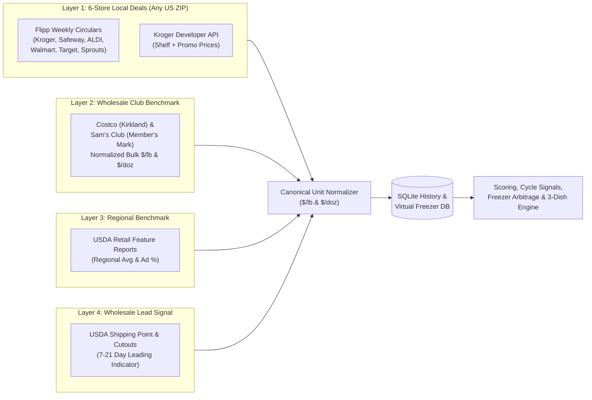

# Architecture & Data Pipeline

## 1. Four-Layer Data Ingestion & Benchmarking Pipeline

PantryBot combines four complementary data layers so that local supermarket sale prices are always evaluated in the context of multi-vendor weekly circulars, warehouse club bulk baselines, regional retail averages, and wholesale commodity movements.

### Layer 1: 6-Vendor Local Store Actuals (`src/lib/connectors/flipp.ts` & `src/data/store-registry.ts`)
* **Flipp Circular Feed (`backflipp.wishabi.com/flipp/items/search?postal_code={zip}`):**
  * Requires **zero authentication** and supports any 5-digit US ZIP code.
  * Queries active weekly flyer items across all 6 supported supermarket ecosystems: **Kroger** (King Soopers, Ralphs, Fred Meyer, Fry's), **Albertsons** (Safeway, Vons, Jewel-Osco, Tom Thumb), **ALDI**, **Walmart**, **Target**, and **Sprouts Farmers Market**.
* **Kroger Official Developer API (`api.kroger.com/v1/products`):**
  * Uses OAuth2 Client Credentials (`product.compact` scope) to retrieve both `price.regular` and `price.promo` shelf pricing.

### Layer 2: Wholesale Club Bulk Price Normalizer (`src/data/wholesale-club-benchmarks.ts`)
* Benchmarks every canonical commodity against **Costco Wholesale (Kirkland Signature)** and **Sam's Club (Member's Mark)** everyday bulk package pricing normalized to `$/lb` and `$/doz`.
* Flags whether a supermarket circular sale **beats warehouse club bulk pricing (`🏆 Beats Costco/Sam's Bulk -X%`)** or whether **buying in bulk at Costco/Sam's Club is cheaper (`📦 Club Bulk Cheaper`)**.

### Layer 3 & 4: USDA MyMarketNews (MARS API v1.2)
Queried via `https://marsapi.ams.usda.gov/services/v1.2/reports/{slug_id}`:
* **`3324` (`FVWRETAIL`):** National Retail Report — Specialty Crops (Produce).
* **`3228` (`AMS_3228`):** Weekly Grocery Store Beef Feature Activity.
* **`2868` (`AMS_2868`):** Weekly Grocery Store Pork Feature Activity.
* **`2756` (`AMS_2756`):** Weekly Grocery Store Chicken/Poultry Feature Activity.
* **`2995` (`DYBRETAIL`):** Weekly Grocery Store Dairy & Egg Feature Activity.

---

## 2. Canonical Ingredient Catalog & Unit Normalization

Grocery circulars advertise products in mixed units (`"4 for $5"`, `"$0.77/ea"`, `"16 oz roll"`, `"5 lb bag"`). To compare all 6 supermarkets, Costco/Sam's Club, and USDA baselines accurately, every matched offer is mapped to one of 29 **Canonical Ingredients** (`src/data/canonical-ingredients.ts`) and converted to `normalizedPricePerUnit` (`$/lb` or `$/doz`):

| Input Pattern | Normalization Rule | Example |
| :--- | :--- | :--- |
| Explicit Bag Weight (`5 lb bag`) | `salePrice / bagLbs` | `$1.99 / 5 lb bag` Russet Potatoes $\rightarrow$ **`$0.40/lb`** |
| Ounce Package (`8 oz`, `14 oz`, `32 oz`) | `salePrice / (oz / 16)` | `$1.49 / 8 oz` Shredded Cheese $\rightarrow$ **`$2.98/lb`** |
| Sold by Count (`ea`, `bunch`) | `salePrice / avgEachWeightLb` | `$0.77/ea` Bell Pepper (`0.38 lb`) $\rightarrow$ **`$2.03/lb`** |
| Egg Cartons (`12 ct`, `18 ct`, `24 ct`) | `(salePrice / count) * 12` | `$1.99 / 12 ct` Large Eggs $\rightarrow$ **`$1.99/doz`** |

---

## 3. SQLite Persistence Layer (`src/lib/db/sqlite.ts`)

PantryBot uses Node's built-in `node:sqlite` (`DatabaseSync`) stored at `data/mead-price-history.sqlite` to persist four core tables:

1. **`weekly_price_history`:** Stores multi-week normalized price snapshots per ingredient and store, powering 6-week sparklines and **6-Week Cycle Floor vs. Peak (`sixWeekLow`, `sixWeekHigh`, `sixWeekMedian`)** signals.
2. **`sync_runs`:** Audit log of weekly Flipp + Kroger + USDA sync executions.
3. **`saved_recipes`:** User-bookmarked meal-prep blueprints and custom Gemini AI recipes (`/api/saved-recipes`).
4. **`freezer_inventory` (`v1.2`):** Persistent **Virtual Freezer** table (`/api/freezer` `GET`, `POST`, `PATCH`, `DELETE`) storing banked freezer items (`canonical_ingredient_id`, `quantity_lb`, `purchase_price_per_unit`, `regular_price_per_unit`, `store`, `added_date_iso`, `notes`) for multi-week protein arbitrage.

---

## 4. Deal Redemption Classification

Every `StoreOffer` is classified into one of four redemption mechanics so the shopper knows how to unlock the price at checkout:
* `DIGITAL_COUPON`: Requires clipping in the Kroger/King Soopers, Safeway for U, Target Circle, or Sprouts mobile app.
* `MULTI_BUY`: Requires purchasing a minimum quantity (e.g., *Must buy 3 to get $1.77/ea*).
* `SHELF_OR_MEMBER`: Automatically applied with a loyalty card or phone number at checkout.
* `EVERYDAY_LOW`: Zero-coupon Everyday Low Price (EDLP) at ALDI or Walmart.
