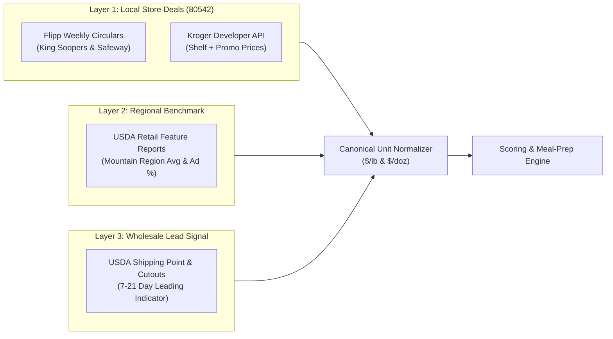

# Architecture & Data Pipeline

## 1. Three-Layer Data Ingestion

The system combines three complementary data sources so that local sale prices are always evaluated in the context of regional retail averages and wholesale commodity movements.

### Layer 1: Local Store Actuals (`src/lib/connectors/flipp.ts` & `usda-and-kroger.ts`)
* **Flipp Circular Feed (`backflipp.wishabi.com/flipp/items/search?postal_code=80542`):**
  * Requires **zero authentication**.
  * Returns active weekly flyer items for both **King Soopers** and **Safeway**, including sale prices, digital coupon callouts (`sale_story`), and valid dates.
* **Kroger Official Developer API (`api.kroger.com/v1/products`):**
  * Uses OAuth2 Client Credentials (`product.compact` scope).
  * Queries specific King Soopers `locationId`s near `80542` to retrieve both `price.regular` and `price.promo` for items even when they aren't featured on the front page of the circular.

### Layer 2 & 3: USDA MyMarketNews (MARS API v1.2)
Queried via `https://marsapi.ams.usda.gov/services/v1.2/reports/{slug_id}`:
* **`3324` (`FVWRETAIL`):** National Retail Report — Specialty Crops (Produce). Filtered to the **Mountain Region** for weighted average advertised price and store feature percentage.
* **`3228` (`AMS_3228`):** Weekly Grocery Store Beef Feature Activity.
* **`2868` (`AMS_2868`):** Weekly Grocery Store Pork Feature Activity.
* **`2756` (`AMS_2756`):** Weekly Grocery Store Chicken/Poultry Feature Activity.
* **`2995` (`DYBRETAIL`):** Weekly Grocery Store Dairy & Egg Feature Activity.

---

## 2. Canonical Ingredient Catalog & Unit Normalization

Grocery circulars advertise products in mixed units (`"4 for $5"`, `"$0.77/ea"`, `"16 oz roll"`, `"5 lb bag"`). To compare King Soopers, Safeway, and USDA baselines accurately, every matched offer is mapped to a **Canonical Ingredient** (`src/data/canonical-ingredients.ts`) and converted to `normalizedPricePerUnit` (`$/lb` or `$/doz`):

| Input Pattern | Normalization Rule | Example |
| :--- | :--- | :--- |
| Explicit Bag Weight (`5 lb bag`) | `salePrice / bagLbs` | `$1.99 / 5 lb bag` Russet Potatoes $\rightarrow$ **`$0.40/lb`** |
| Ounce Package (`8 oz`, `14 oz`, `32 oz`) | `salePrice / (oz / 16)` | `$1.49 / 8 oz` Shredded Cheese $\rightarrow$ **`$2.98/lb`** |
| Sold by Count (`ea`, `bunch`) | `salePrice / avgEachWeightLb` | `$0.77/ea` Bell Pepper (`0.38 lb`) $\rightarrow$ **`$2.03/lb`** |
| Egg Cartons (`12 ct`, `18 ct`) | `(salePrice / count) * 12` | `$1.99 / 12 ct` Large Eggs $\rightarrow$ **`$1.99/doz`** |

---

## 3. Deal Redemption Classification

Every `StoreOffer` is classified into one of four redemption mechanics so the shopper knows how to get the price at checkout:
* `DIGITAL_COUPON`: Requires clipping in the King Soopers or Safeway mobile app (often with a quantity limit such as *Limit 2* or *Limit 5*).
* `MULTI_BUY`: Requires purchasing a minimum quantity (e.g., *Must buy 3 to get $1.77/ea*).
* `SHELF_OR_MEMBER`: Automatically applied when scanning a SooperCard or entering a phone number at Safeway.
* `EVERYDAY_LOW`: Standard non-promotional shelf price.
