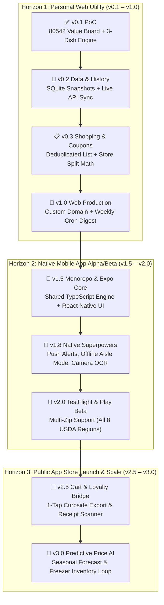
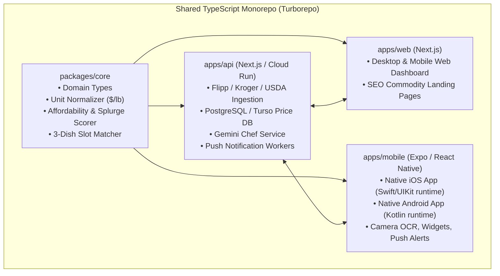

# North Star Strategy: Native iOS/Android Roadmap & Feature Expansion Blueprint

This document serves as the long-term product and technical blueprint for evolving the **Produce & Commodity Meal-Prep Value Tracker** from a personal Mead, CO (`80542`) web tool into a published **iOS (App Store)** and **Android (Google Play)** native application.

---

## 1. High-Level Multi-Horizon Roadmap (`v0.1` -> `v3.0`)

| Horizon | Target Versions | Primary Goal | Target Audience | Form Factor |
| :--- | :--- | :--- | :--- | :--- |
| **Horizon 1: Foundation** | `v0.1` – `v1.0` | Nail the core value score, weekly circular ingestion, shopping list, and 3-dish stew/casserole loop. | Personal / Household (`80542` Mead, CO) | Mobile-Responsive Web App + PWA |
| **Horizon 2: Native Transition** | `v1.5` – `v2.0` | Package into native iOS & Android apps with push notifications, camera price-checking, and nationwide zip code support. | Friends, Family & Early Beta Testers (TestFlight / Google Play Internal) | Native iOS & Android (Expo / React Native) |
| **Horizon 3: Public Scale** | `v2.5` – `v3.0` | Multi-banner store expansion, curbside cart export, freezer-to-meal-prep loop, and App Store monetization. | Budget-conscious meal preppers & families nationwide | Public iOS App Store & Google Play Store |

---

## 2. Technical Strategy: Web-to-Native Architecture

Because we built the PoC in **TypeScript + Next.js** with strict separation between the data/scoring engine (`src/lib/`, `src/types/`) and the UI (`src/components/`), we do **not** need to rewrite our core code to ship native iOS and Android apps.

### Recommended Migration Path: Turborepo + Expo (React Native)

* **90% Code Reuse:** All TypeScript interfaces, scoring formulas, and React hooks carry over directly from our current Next.js codebase.
* **Cloud Builds (EAS):** Expo Application Services (EAS) lets us build and submit signed iOS `.ipa` binaries to Apple TestFlight and Android `.aab` bundles to Google Play straight from GitHub Actions.
* **Over-the-Air (OTA) Updates:** Fix circular parsing bugs or UI tweaks instantly via `eas update` without waiting for App Store review.

---

## 3. Native-Only Features Unlocked by iOS & Android (Prioritized)

### Priority #1: Smart Push Notifications (High-Signal, Zero Spam)
* **Wednesday 7:00 AM ("New Circulars Analyzed"):** Highlights the deepest meat and produce cycle lows at King Soopers and Safeway as soon as weekly ads drop.
* **Friday 4:00 PM ("Weekend Prep Reminder"):** Summarizes the 3-dish cost per serving and digital coupons to clip before weekend shopping.
* **Commodity Spike Warning:** Alerts when USDA wholesale prices spike while local retail promos are still cheap.

### Priority #2: In-Aisle Barcode Scanner (UPC & Price Check)
* Scan any meat, dairy, or produce UPC barcode in King Soopers or Safeway.
* Instantly looks up the item against the USDA Mountain Region baseline, wholesale trend, and rival store's circular price (*"Safeway has this for $1.97/lb with digital coupon vs $3.49/lb here"*).

### Priority #3: iOS Live Activities, Dynamic Island & Home Screen Widgets
* **Lock Screen Shopping Mode:** Pins remaining shopping list items and unclipped digital coupons directly onto the iOS Lock Screen and Dynamic Island while in the store.
* **Wednesday Ad-Drop Home Screen Widget:** Displays the week's Top 3 Meat & Produce Cycle Lows on the home screen every Wednesday morning.

### Priority #4: Receipt Scanning & Realized Savings Tracker
* Scans paper or digital receipts to track cumulative household grocery savings over time and crowdsource verified shelf prices.

---

## 4. Product & Feature Expansion Pillars

1. **Pillar 1: Geographic & Multi-Chain Expansion (Beyond `80542`)**
   * Support any 5-digit US zip code mapped to all 8 USDA Market News Regions.
   * Expand across all Kroger & Albertsons banners plus **ALDI**, **Sprouts**, **Costco / Sam's Club** (bulk unit normalizer), and **Walmart / Target** everyday price floors.
2. **Pillar 2: The "Freezer & Pantry Loop" (Multi-Week Arbitrage)**
   * Prompt *"Buy 2, Prep 1, Freeze 1"* during deep cycle lows (`>45% off`), logging the second roast into a **Virtual Freezer** that the 3-Dish Matcher uses at `$0.00` out-of-pocket cost on future weeks when meat sales are weak.
3. **Pillar 3: Personalized Culinary & Nutrition Profiles**
   * Support customizable cooking styles (*One-Pot Stews & Casseroles*, *Sheet-Pan*, *Smoker/Grill*, *High-Protein Macro Mode*), dynamic portion scaling, and leftover ingredient rescue.
4. **Pillar 4: Predictive Price Forecasting ("Commodity Weather Forecast")**
   * Use longitudinal SQLite/Postgres circular history + USDA shipping-point volumes to predict 4-to-6-week store promotional cycles and seasonal peak harvest windows.
5. **Pillar 5: 1-Tap Curbside Cart Export & Sustainable Monetization**
   * Integrate with the official **Kroger Cart API (`cart.basic:write`)** and Instacart links to export all 3-dish ingredients directly into a curbside pickup cart in one tap.

---

## 5. Architectural Guardrails for Horizon 1 (`v0.2` – `v1.0`)

1. **Keep Core Logic UI-Agnostic:** Keep all scoring, unit normalization, and recipe matching in pure TypeScript modules (`src/lib/` and `src/types/`) with zero DOM dependencies so `apps/mobile` can import them directly.
2. **Design APIs for Both Web & Mobile:** Keep Next.js API routes returning clean JSON payloads ready for both web and React Native clients.
3. **Parameterize Location (`zipCode`) Everywhere:** Always pass `zipCode` and `region` as parameters (defaulting to `80542` / `Mountain`).
