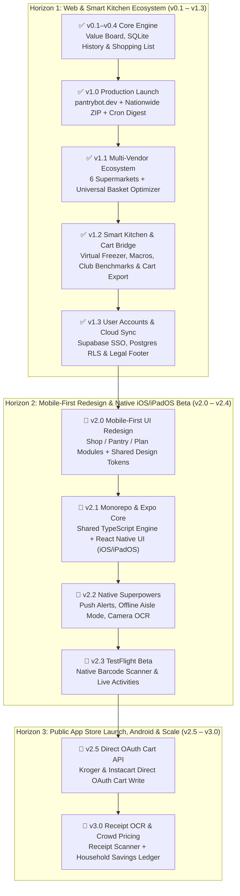
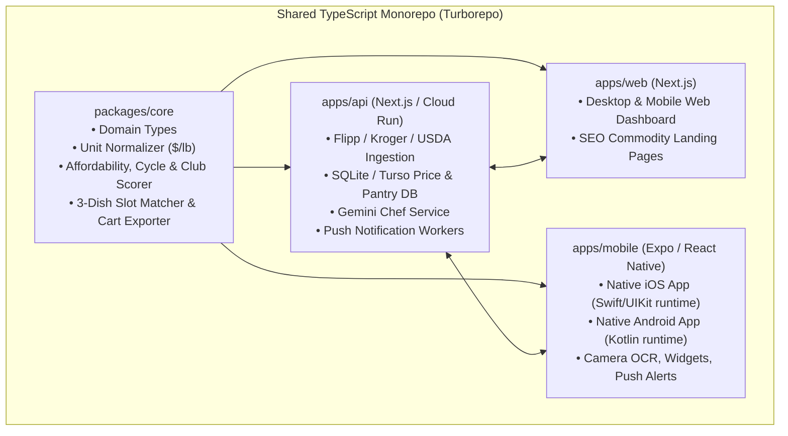

# North Star Strategy: Native iOS/Android Roadmap & Feature Expansion Blueprint

This document serves as the long-term product and technical blueprint for evolving **PantryBot** from a personal Mead, CO (`80542`) web tool into a published **iOS (App Store)** and **Android (Google Play)** native application.

---

## 1. High-Level Multi-Horizon Roadmap (`v0.1` -> `v3.0`)

> **Versioning note:** Web **v2.0** is the mobile-first UI redesign (Shop, Pantry and Plan modules on a shared design system; see the [v2.0 draft spec](../specs/v2.0-ui-redesign.md)). It is the first step toward native, so the native alpha/beta now runs as **v2.x** (iOS and iPadOS first), followed by public launch. Android follows after the iOS/iPadOS beta. Earlier drafts of this page used `v1.5`–`v2.0` for native.

| Horizon | Target Versions | Primary Goal | Target Audience | Form Factor |
| :--- | :--- | :--- | :--- | :--- |
| **Horizon 1: Web & Smart Kitchen** | `v0.1` – `v1.3` | Core value score, 6-vendor circular ingestion, Virtual Freezer arbitrage, macro/dietary profiles, Costco/Sam's Club normalizer, 1-tap cart export, and Supabase SSO / Cloud Sync. | Nationwide Web & PWA Users (`pantrybot.dev`) | Mobile-Responsive Web App + Installable PWA |
| **Horizon 2: Redesign & Native Transition** | `v2.0` – `v2.4` | Ship the mobile-first redesign (v2.0), then package native iPhone and iPad apps with push notifications, camera barcode/shelf-tag OCR, and iOS Lock Screen Live Activities. | Friends, Family & Early Beta Testers (TestFlight) | Mobile-first Web/PWA (v2.0), then Native iOS & iPadOS (Expo / React Native) |
| **Horizon 3: Public Scale** | `v2.5` – `v3.0` | Direct OAuth Cart API write (`cart.basic:write`), receipt scanning ledger, and App Store monetization. | Budget-conscious meal preppers & families nationwide | Public iOS/iPadOS App Store, then Google Play Store |

---

## 2. Technical Strategy: Web-to-Native Architecture

Because we built PantryBot in **TypeScript + Next.js** with strict separation between the data/scoring engine (`src/lib/`, `src/types/`, `src/data/`) and the UI (`src/components/`), we do **not** need to rewrite our core code to ship native iOS and Android apps.

### Recommended Migration Path: Turborepo + Expo (React Native)

* **90% Code Reuse:** All TypeScript interfaces, scoring formulas, wholesale club benchmarks, cart export formatters, and React hooks carry over directly from our current Next.js codebase.
* **Cloud Builds (EAS):** Expo Application Services (EAS) lets us build and submit signed iOS `.ipa` binaries to Apple TestFlight and Android `.aab` bundles to Google Play straight from GitHub Actions.
* **Over-the-Air (OTA) Updates:** Fix circular parsing bugs or UI tweaks instantly via `eas update` without waiting for App Store review.

---

## 3. Native-Only Features Unlocked by iOS & Android (Prioritized for `v2.1+`)

### Priority #1: Native Push Notifications (APNs & FCM)
* **Wednesday 7:00 AM ("New Circulars Analyzed"):** Highlights the deepest meat and produce cycle lows across your selected stores as soon as weekly ads drop.
* **Friday 4:00 PM ("Weekend Prep Reminder"):** Summarizes the 3-dish cost per serving, Pantry ingredients to check, and digital coupons to clip before weekend shopping.

### Priority #2: In-Aisle Barcode Scanner (UPC & Price Check)
* Scan any meat, dairy, or produce UPC barcode in the aisle to compare against the 6-week price floor, Costco/Sam's Club bulk unit price, and rival supermarkets.

### Priority #3: iOS Live Activities, Dynamic Island & Home Screen Widgets
* **Lock Screen Shopping Mode:** Pins remaining shopping list items and unclipped digital coupons directly onto the iOS Lock Screen and Dynamic Island while in the store.
* **Wednesday Ad-Drop Home Screen Widget:** Displays the week's Top 3 Meat & Produce Cycle Lows on the home screen every Wednesday morning.

### Priority #4: Receipt Scanning & Realized Savings Tracker
* Scans paper or digital receipts to track cumulative household grocery savings over time and suggest Pantry updates for explicit review.
