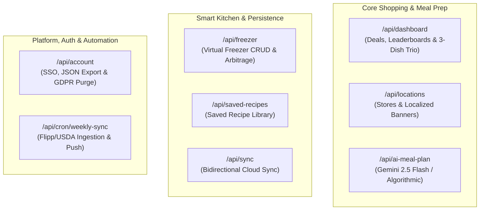

# OpenAPI 3.1.0 Specification & Swagger UI Console

PantryBot exposes a production-ready, standardized **OpenAPI 3.1.0** specification covering all backend routes, data models, and security schemes, alongside an embedded **Swagger UI** testing and documentation console.

---

## 1. Endpoints & Access

| Resource | Route | Format | Description |
| :--- | :--- | :--- | :--- |
| **Interactive Swagger UI** | [`/docs`](http://localhost:3000/docs) (or `/api-docs`, `/swagger`) | HTML / Client UI | Interactive Swagger console to test routes, execute payloads, and inspect schema types. |
| **OpenAPI 3.1 Specification** | [`/api/openapi.json`](http://localhost:3000/api/openapi.json) | JSON (REST) | Dynamic OpenAPI 3.1.0 JSON document served with CORS headers (`Access-Control-Allow-Origin: *`) and caching. |
| **Static Schema File** | `docs/openapi.json` | JSON File | Offline-first, static version of the OpenAPI spec for CI linters, SDK generators, or Spectral audits. |

---

## 2. API Domain Overview

The PantryBot REST API is structured into 8 functional domains:



### 1. `GET /api/dashboard`
* **Query Parameters:** `zip` (default `80542`), `store` (`ALL` or `StoreChain`), `stores` (comma-separated), `pinned` (ingredient IDs), `onHand` (ingredient IDs), `servings` (`4`, `6`, `8`), `macroGoal` (`ANY`, `HIGH_PROTEIN`, `LOW_CARB_KETO`, `CALORIE_CONSCIOUS`, `BALANCED_FAMILY`), `dietary` (comma-separated), `vessel` (`CookingVesselArchetype`).
* **Response:** Returns `DashboardPayload` including commodities, value scores, recommended 3-dish batch prep trio, single-store & 2-store split trip optimizer, wholesale club comparisons, and 6-week cycle signals.

### 2. `GET /api/locations`
* **Query Parameters:** `zipCode` / `zip` (5-digit US ZIP).
* **Response:** List of supported supermarket banners (King Soopers, Safeway, ALDI, Walmart, Target, Sprouts), loyalty app metadata, and local physical store branches.

### 3. `/api/freezer` (Virtual Freezer CRUD)
* `GET /api/freezer`: Retrieves active virtual freezer inventory items.
* `POST /api/freezer`: Upserts a purchased ingredient with automated weighted-average cost basis and estimated savings.
* `PATCH /api/freezer`: Updates quantity of banked ingredient.
* `DELETE /api/freezer?id={id}`: Removes an item by ID.
* *Protected by Origin verification (`verifySameOrigin`) and rate limiting.*

### 4. `/api/saved-recipes` (Saved Recipe Library)
* `GET /api/saved-recipes`: Retrieves bookmarked recipes and custom AI plans.
* `POST /api/saved-recipes`: Saves a `RecommendedDish` into the recipe library.
* `DELETE /api/saved-recipes?id={id}`: Deletes a saved recipe.

### 5. `POST /api/ai-meal-plan` (Gemini AI Meal Planner)
* Calls Google GenAI (`gemini-2.5-flash`) with live store sale items, nutritional profiles, and dietary constraints.
* **Zero-Key Offline Resilience:** If `GEMINI_API_KEY` is not detected in `.env.local` or client payload, automatically falls back to deterministic algorithmic scoring without error.

### 6. `/api/sync` (Cloud Sync Engine)
* `GET /api/sync`: Loads cloud or local session preferences, freezer items, and saved recipes.
* `POST /api/sync`: Persists updated user preferences and kitchen state to Supabase PostgreSQL RLS or SQLite local store.

### 7. `/api/account` (Account Management & GDPR/CCPA)
* `GET /api/account`: Exports complete machine-readable user data archive (`UserDataExportArchive`) under GDPR right to access.
* `POST /api/account`: Handles session authentication (`SIGN_IN_LOCAL`, `SIGN_OUT`).
* `DELETE /api/account`: Irrevocably purges user account and all personal grocery data under GDPR right to erasure.

### 8. `/api/cron/weekly-sync` (Automated Ingestion)
* `GET /api/cron/weekly-sync`: Triggers weekly circular refresh from Flipp and USDA MARS. Persists audit log when called by Vercel Cron (`x-vercel-cron` header) or `record=true`.
* `POST /api/cron/weekly-sync`: Triggers manual sync run with cycle label.

---

## 3. Interactive Testing with Swagger UI

1. Start the development server:
   ```bash
   npm run dev
   ```
2. Navigate to [http://localhost:3000/docs](http://localhost:3000/docs) in your browser.
3. Use the **Quick Filter** pills to narrow endpoints by tag (e.g. *Virtual Freezer*, *AI Meal Planner*, *Dashboard & Deals*).
4. Click **"Try it out"** on any endpoint to execute queries directly against your local backend.
5. Inspect request parameters, response headers (such as `Retry-After`), and schema models.
